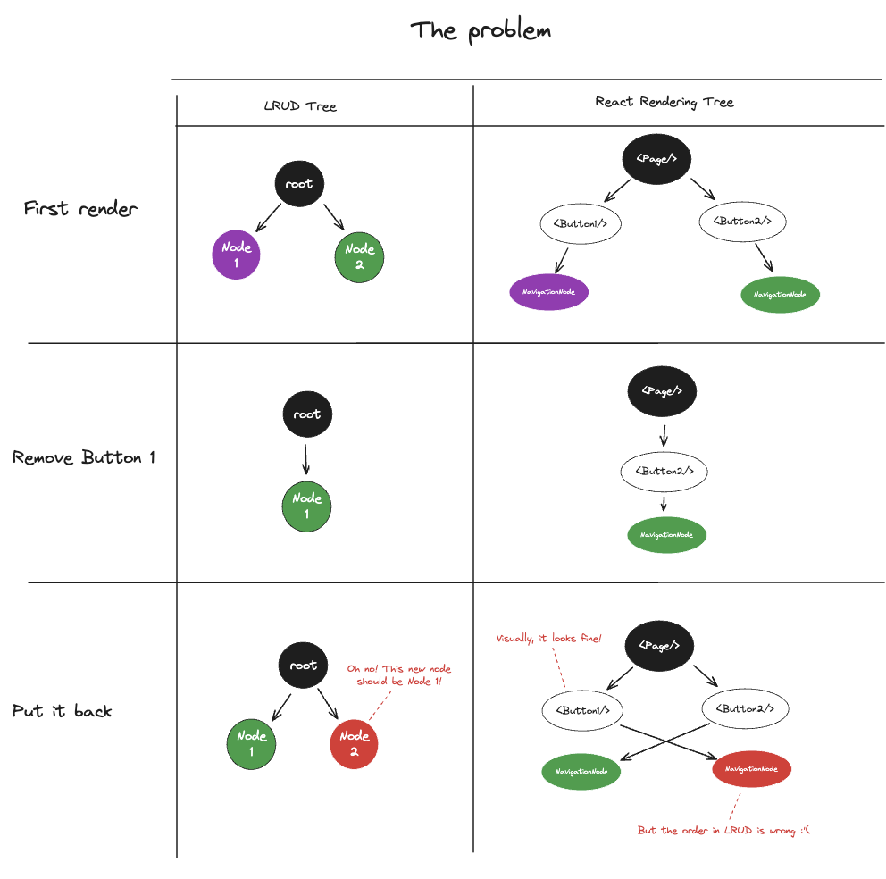
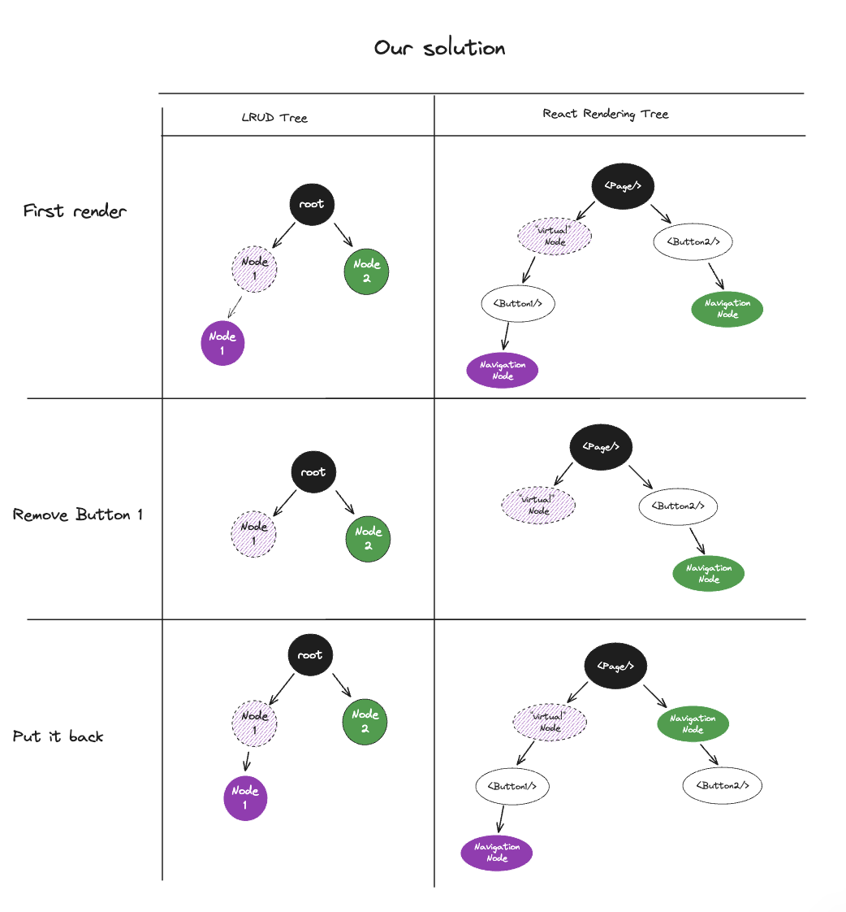

# Pitfalls


- [Conditional rendering](#conditional-rendering)
  - [TLDR](#tldr)
  - [Explanations](#explanations)
- [Accessibility](#accessibility)

## Conditional rendering & dynamic ordering

### TLDR

If navigation elements are conditionnally visible, it is necessary to wrap them with a node that will always be present. Otherwise the registering of the elements might change.

```tsx
// DON'T ❌
<View>
  <Text>Title</Text>
  {isVisible && <Element />}
</View>

// DO ✅
<View>
  <Text>Title</Text>
  <SpatialNavigationNode>{isVisible && <Element />}</SpatialNavigationNode>
</View>
```

The same goes for mapping over a list of elements that can change. The trick in that case is to wrap the elements with a SpatialNavigationNode that is keyed by the list index.
Yes, this is bad practice in general, but it is justified here because we really want the SpatialNavigationNode components to never change even if the list moves.
It will force the children to re-render but we have no better recommendation yet!

```tsx
// DON'T ❌
<View>
  {elements.map((element) => <Element element={element} />)}
</View>

// DO ✅
<View>
  {elements.map((element, index) =>
    <SpatialNavigationNode key={index}>
      <Element element={element} />)
    </SpatialNavigationNode>
  }
</View>
```

### Explanations

If you try to hide and then show a button again naively using the library, you’ll encounter an issue.
Once re-rendered, your button will not be at the proper place! Well, for the remote control only.
Your button will still be at the top of your page, but it will be as if it was at the bottom for the remote control.



Why?

When we declare elements in LRUD, we declare them in the same order as the React rendering.
It’s our only way to know that Button 1 is above Button 2.
The problem with that, is that if you remove Button 1 from your React tree and put it back, it’s still Button1 + Button2 for React,
but the order of the LRUD declaration will change: Button1 will land AFTER Button2 for LRUD.



Solution is simple, but you need to know about it.
You simply need to wrap your conditionally rendered elements with a `<SpatialNavigationNode/>` that you never remove from the tree.
You remove its children only.
Once you do that, there is always an LRUD node living at the place of your button, and there won’t be any confusion order once your button comes back!

## The focus is lost when the content of a screen is re-rendered

### TLDR

Use the `restoreFocus` prop of the `SpatialNavigationRoot` if you want the focus to go back to the
element the user was on when they come back to a screen.

### Explanations

The nodes are registered in LRUD when they are mounted, and unregistered when they are unmounted.
When the focused node is unregistered, LRUD forgets where the focus was: the focus is lost, and
another element takes it.

This is a problem in a multi-screen app: the user is on the third item of a list, they navigate to
another screen, the content of the first screen is re-rendered, and they come back: the focus is
on the first item of the list, and not on the third one. The "select" button is then sent to the
wrong element, because the select event is sent to the focused element.

With `restoreFocus`, the root remembers where the focus was when it was deactivated, and gives it
back when it becomes active again:

```jsx
<SpatialNavigationRoot isActive={activeScreen === 'home'} restoreFocus>
  {/* ... */}
</SpatialNavigationRoot>
```

## Accessibility

As mentioned in [accessibility](./accessibility.md), support is experimental. And help is welcome 🙂

## React Strict Mode

It can't work 😢 Long story short: we're relying on React's rendering order
to register our elements, and the strict mode is messing with it.

You can [check this talk out](https://www.youtube.com/watch?v=Asn1TmCH2b0) to understand why.
